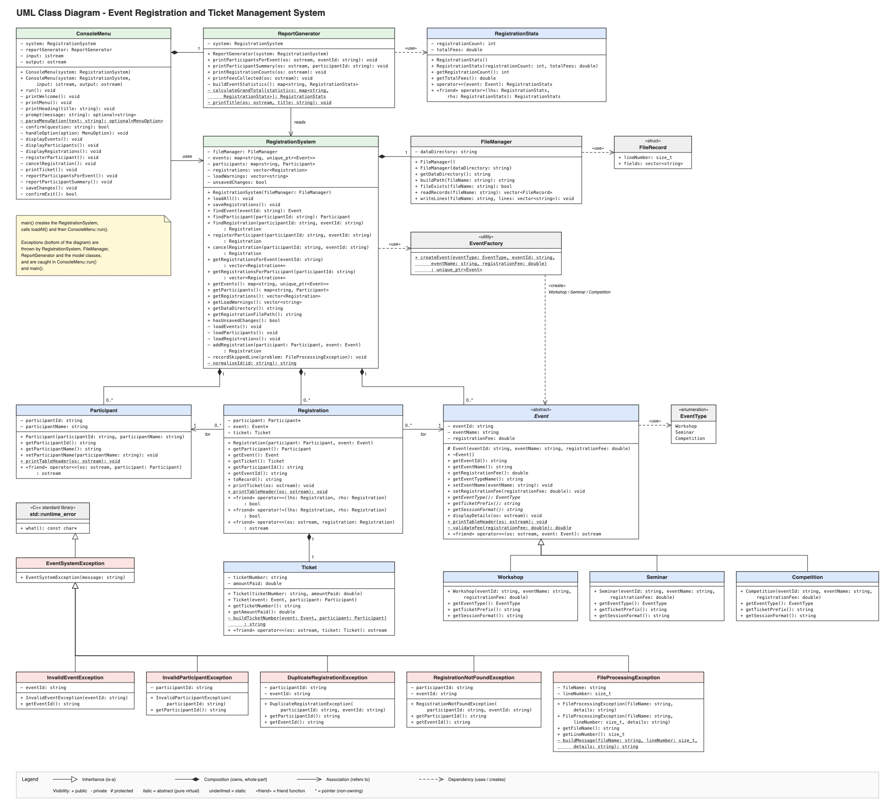

# Event Registration and Ticket Management System

## 1. Project Information

| Item | Details |
|---|---|
| Assignment | Event Registration and Ticket Management |
| Course | XBCS2014N Advanced Programming |
| Learning outcomes | SLO2 (object-oriented design and implementation in C++), SLO4 (advanced C++ features) |
| Student name | Dinura |
| Student ID | *[your student ID]* |
| Submission date | *[submission date]* |
| Language / standard | C++17 (`g++ -std=c++17`) |

---

## 2. System Overview

The **Event Registration and Ticket Management System** is a console application that manages
workshops, seminars and competitions, the people who take part in them, and their registrations.

All data is kept in plain text files, so the system works without a database. This follows
**UN Sustainable Development Goal 9 (Industry, Innovation and Infrastructure)**: it replaces manual
paper sign-up sheets with a small, maintainable digital tool built on simple infrastructure.

When the program starts it:

1. reads **`Event.txt`**, **`Participant.txt`** and **`Registration.txt`** (the file structure is unchanged),
2. builds objects for every event (as a `Workshop`, `Seminar` or `Competition`), every participant and
   every registration,
3. shows a menu where the user can view data, register or cancel registrations, print tickets,
   produce reports and save the changes back to `Registration.txt`.

Every registration gets an **admission ticket**. Its number is built from the event type, event ID and
participant ID, for example `WKS-E001-P001`. Because the number is derived from data that is already
stored, no extra fields are needed in the provided files.

---

## 3. Features Implemented

| Requirement | Feature | Where |
|---|---|---|
| 1a | Load event information from `Event.txt` | `RegistrationSystem::loadEvents()`, `FileManager::readRecords()`, `EventFactory` |
| 1b | Display available events | Menu option **1**, `Event::operator<<` |
| 1c | Store event ID, name, type and fee | `Event` (private data) + `Workshop` / `Seminar` / `Competition` |
| 2a | Load participant information from `Participant.txt` | `RegistrationSystem::loadParticipants()` |
| 2b | Display participant records | Menu option **2**, `Participant::operator<<` |
| 2c | Store participant ID and name | `Participant` |
| 3a | Load registrations from `Registration.txt` | `RegistrationSystem::loadRegistrations()` |
| 3b | Register participants for events | Menu option **4**, `RegistrationSystem::registerParticipant()` |
| 3c | Cancel registrations | Menu option **5**, `RegistrationSystem::cancelRegistration()` |
| 3d | Display registration information | Menu option **3** (all registrations) and option **6** (ticket) |
| 3e | Prevent duplicate registrations; one participant may join many events | `Registration::operator==` + `std::find` → `DuplicateRegistrationException` |
| 4a | List of participants registered for a particular event | Menu option **7**, `ReportGenerator::printParticipantsForEvent()` |
| 4b | Registration summary for a participant | Menu option **8**, `ReportGenerator::printParticipantSummary()` |
| 4c | Total number of registrations for each event | Menu option **9**, `ReportGenerator::printRegistrationCounts()` |
| 4d | Total registration fees collected for each event | Menu option **10**, `ReportGenerator::printFeesCollected()` |
| B | Save modifications back to the file | Menu option **11**, and a prompt when exiting with unsaved changes |

Additional robustness features:

* IDs are case-insensitive and trimmed (`p001` and ` P001 ` both find `P001`).
* Malformed lines, unknown IDs and duplicate lines in the data files are **skipped with a warning**
  (showing file name and line number) instead of stopping the program.
* Windows (CRLF) line endings and a UTF-8 byte-order mark in the data files are handled.
* Saving writes to a temporary file first and then renames it, so `Registration.txt` is never left half-written.
* If the input ends (e.g. Ctrl+D or the end of a piped file), the program exits cleanly instead of looping.

---

## 4. Project Structure

```
Assignment/
├── driver.cpp          Program entry point – main()
├── header.hpp          Declarations of all constants, helper functions and classes
├── header.cpp          Implementations of everything declared in header.hpp
├── README.md           This document
├── classDiagram.jpg    UML class diagram
├── Event.txt           Provided input file (structure not modified)
├── Participant.txt     Provided input file (structure not modified)
└── Registration.txt    Provided input file (structure not modified; updated when changes are saved)
```

---

## 5. Role of Each Source File

The program uses **separate compilation**. `header.hpp` holds the declarations (the interface).
`header.cpp` and `driver.cpp` are compiled separately and then linked together.

### `header.hpp` – declarations (interface)

Both `.cpp` files include this file. A traditional `#ifndef HEADER_HPP` guard stops it from being
included more than once. It is organised into numbered sections, in dependency order:

| Section | Contents |
|---|---|
| 1. `namespace config` | Compile-time constants (`inline constexpr`): data file names, the `;` delimiter, expected field counts per record, the default data folder and the currency symbol. |
| 2. `namespace textutils` | Stateless helpers: `trim`, `toUpper`, `split` (keeps empty fields so malformed records can be detected), `parseAmount` (strict number parsing), `formatAmount`, `formatCurrency`. |
| 3. `EventType` | `enum class EventType { Workshop, Seminar, Competition }` with `toString()` and `parseEventType()`. |
| 4. Exceptions | `EventSystemException` (derived from `std::runtime_error`) and its subclasses `InvalidEventException`, `InvalidParticipantException`, `DuplicateRegistrationException`, `RegistrationNotFoundException`, `FileProcessingException`. |
| 5. `Event` hierarchy | `Event` is the **abstract base class**: private ID, name and fee, a `protected` constructor, three pure virtual functions and a virtual destructor. **Derived classes** `Workshop`, `Seminar` and `Competition` (`final`) override the virtual functions. |
| 6. `EventFactory` | Creates the right derived event for an `EventType` and returns it as `std::unique_ptr<Event>`. |
| 7. `Participant` | A participant (ID, name) with validation and a friend `operator<<`. |
| 8. `Ticket` | The admission ticket (ticket number, amount paid), with two constructors where the second delegates to the first. |
| 9. `Registration` | Links a `Participant` and an `Event` (association) and owns a `Ticket` (composition). It defines the friend `operator==`, `operator!=` and `operator<<`. |
| 10. `RegistrationStats` | Accumulates a count and total fees. `operator+=(const Event&)` adds one registration; the friend `operator+` combines two sets of statistics. |
| 11. `FileRecord`, `FileManager` | Low-level file processing: reads lines into records and writes lines back safely. |
| 12. `RegistrationSystem` | The core class. It owns every event, participant and registration; loads and saves the data; and performs look-ups, registration, cancellation and queries. |
| 13. `ReportGenerator` | Produces the four reports (4a–4d). |
| 14. `ConsoleMenu` | The text user interface. It shows the menu, reads input, calls the system and handles every exception. |

### `header.cpp` – implementations

It contains the member-function definitions for every class in `header.hpp`, in the same section
order. Column widths used for table output are kept in an anonymous namespace (private to this file).
They are grouped per class (`eventTable`, `participantTable`, `registrationTable`, `ticketLayout`,
`reportTable`), so each header row always lines up with the rows printed by `operator<<`.

### `driver.cpp` – program entry point

`main()` chooses the data folder (a command-line argument, otherwise the current folder), creates the
`RegistrationSystem`, loads the three files and runs the `ConsoleMenu`. It catches fatal file errors,
printing a usage message, and any other unexpected exception.

---

## 6. Compilation Instructions

**Requirement:** a C++17 compiler (GCC 8+ or Clang 7+, e.g. MinGW-w64 on Windows).

From the folder that contains the files:

```bash
g++ -std=c++17 -Wall -Wextra -Wpedantic driver.cpp header.cpp -o event_system
```

On Windows the output file can be named `event_system.exe`. The same command works in Command Prompt
or PowerShell.

---

## 7. Execution Instructions

```bash
./event_system              # reads Event.txt, Participant.txt and Registration.txt from the current folder
./event_system path/to/dir  # reads the three files from another folder
```

On Windows, run `event_system.exe`.

`Event.txt` and `Participant.txt` are required. If `Registration.txt` is missing, the program starts
with no registrations and creates the file on the first save.

### Main menu

```
------------------------- MAIN MENU -------------------------
 Event & Participant Management
    1. Display all events
    2. Display all participants
 Registration Management
    3. Display all registrations
    4. Register a participant for an event
    5. Cancel a registration
    6. Print a ticket
 Reports
    7. Participants registered for an event
    8. Registration summary for a participant
    9. Total registrations for each event
   10. Total registration fees collected for each event
 File
   11. Save changes to Registration.txt
    0. Exit
-------------------------------------------------------------
```

Registrations and cancellations are kept in memory until **option 11** is chosen. When exiting with
unsaved changes, the program asks whether to save (Y), discard (N) or cancel the exit (C).

### Example ticket (option 6, participant `P001`, event `E001`)

```
+--------------------------------------------------------------+
|                    EVENT ADMISSION TICKET                    |
+--------------------------------------------------------------+
| Ticket No   : WKS-E001-P001                                  |
| Participant : Ali Hassan (P001)                              |
| Event       : C++ Workshop (E001)                            |
| Event Type  : Workshop                                       |
| Fee Paid    : RM 150.00                                      |
| Format      : Hands-on practical session - bring your laptop |
+--------------------------------------------------------------+
```

---

## 8. UML Class Diagram



**Notation** (as taught in "Programming with Class I–III"): `+` public, `-` private, `#` protected;
*italic* operations are pure virtual (abstract); <u>underlined</u> operations are static; return types
follow the colon; `«friend»` marks a friend function.

| Relationship | Classes | Meaning |
|---|---|---|
| **Inheritance** (is-a) | `Workshop`, `Seminar`, `Competition` → `Event` | Each event type *is an* `Event` and overrides its pure virtual functions. |
| **Inheritance** | 5 exception classes → `EventSystemException` → `std::runtime_error` | Exception hierarchy. |
| **Composition** (owns) | `RegistrationSystem` ◆ `Event`, `Participant`, `Registration`, `FileManager` | The system creates and destroys these objects. Events are owned through `std::unique_ptr`. |
| **Composition** | `Registration` ◆ `Ticket` | A ticket only exists as part of its registration. |
| **Composition** | `ConsoleMenu` ◆ `ReportGenerator` | The menu owns its report generator. |
| **Association** | `Registration` → `Participant`, `Registration` → `Event` | Non-owning pointers to objects owned by the system. Many registrations can refer to one participant or event. |
| **Association** | `ConsoleMenu` → `RegistrationSystem`, `ReportGenerator` → `RegistrationSystem` | Non-owning references. |
| **Dependency** | `EventFactory` ⇢ `Event` («create»), `RegistrationSystem` ⇢ `EventFactory`, `ReportGenerator` ⇢ `RegistrationStats`, `FileManager` ⇢ `FileRecord`, `Event` ⇢ `EventType` | A class is used temporarily, as a parameter, local variable or return value. |

---

## 9. Design Decisions

### 9.1 Object-oriented design (Part A – SLO2)

* **Classes and objects.** Each real-world entity has its own class: `Event`, `Participant`,
  `Registration`, `Ticket`. Responsibilities are separated into layers:
  `FileManager` handles raw file I/O, `RegistrationSystem` holds the business rules,
  `ReportGenerator` produces reports, and `ConsoleMenu` is the user interface.
  This keeps each class small and easy to test or replace.
* **Encapsulation / information hiding.** All data members are `private` and follow the
  trailing-underscore convention (`eventId_`). They can only be read through `const`,
  `[[nodiscard]]` accessors and changed through validating mutators. For example,
  `setRegistrationFee()` rejects negative fees.
* **Abstraction and inheritance.** `Event` is an abstract class with a `protected` constructor and
  three pure virtual functions. The file stores the event type as text, so `EventFactory` converts
  it into the matching subclass. Adding a new event type (such as `Exhibition`) means adding one
  subclass and one `case` in the factory. No other code changes (Open/Closed principle).
* **Composition vs association.** `RegistrationSystem` owns every object. A `Registration` only
  *refers* to its participant and event, using non-owning pointers, so cancelling a registration
  never deletes a participant or event. The `Ticket` is a value member of `Registration`, so it is
  destroyed with it.
* **Why pointers inside `Registration`?** References would make `Registration` impossible to assign,
  and `std::vector::erase()` needs assignment. The pointers are guaranteed valid because `std::map`
  never moves its elements and events live on the heap behind `std::unique_ptr`. `assert()` checks
  this invariant in debug builds.

### 9.2 Advanced C++ features (Part B – SLO4)

| Feature | How it is used |
|---|---|
| **Runtime polymorphism** | `Event` declares the pure virtual functions `getEventType()`, `getTicketPrefix()` and `getSessionFormat()`. They are called through `std::unique_ptr<Event>` / `const Event&` when listing events, counting events by type, building ticket numbers, printing tickets and showing event details. `Event` has a **virtual destructor**, and every override uses `override`. |
| **Constructor overloading** | `Ticket(string, double)` and `Ticket(const Event&, const Participant&)` (delegating); `FileManager()` and `FileManager(string)` (delegating; `driver.cpp` uses both); `RegistrationStats()` and `RegistrationStats(int, double)`; `ConsoleMenu(system)` and `ConsoleMenu(system, istream&, ostream&)` (delegating); two `FileProcessingException` constructors (delegating). |
| **Operator overloading** | `Registration::operator==` / `operator!=` define when two registrations are the same; `std::find` uses this to prevent duplicates. `RegistrationStats::operator+=` adds a registration's fee, and `operator+` combines statistics; `std::accumulate` uses `operator+` to produce grand totals. `operator<<` prints `Event`, `Participant`, `Ticket` and `Registration` objects in table format. |
| **Friend functions** | Every `operator<<`, `Registration`'s `operator==` / `operator!=` and `RegistrationStats`' `operator+` are friends. They need to read private data but are not members, because the left-hand operand is a stream or because the operation is symmetric between two objects. |
| **Exception handling** | A custom hierarchy is rooted at `EventSystemException`, which derives from `std::runtime_error`. The business classes **throw**; `ConsoleMenu::run()` **catches**, from the most specific handler to the most general, and gives a helpful message. Errors in individual file records are caught per record, so one bad line does not stop the program. `main()` catches fatal file errors. |
| **File processing** | The three files are read with `std::ifstream` / `std::getline`. Changes are written back to `Registration.txt` in the original format (`participantId;eventId`, one per line) using a temporary file and `std::rename`. |
| **Dynamic memory / smart pointers** | Events are created with `std::make_unique` and owned by `std::unique_ptr<Event>`, so there are no manual `new`/`delete` calls and no memory leaks (RAII). `Event`'s copy operations are `= delete` to prevent object slicing. |
| **STL containers and algorithms** | `std::map` gives O(log n) ID look-ups and sorted output. `std::vector` keeps registrations in file order. The code also uses `std::find`, `std::transform`, `std::count_if`, `std::accumulate` and `std::find_if_not` with lambdas. |
| **Other modern C++** | `enum class`, `inline constexpr` constants instead of macros, `[[nodiscard]]`, `final`, `= default` / `= delete`, move semantics (`std::move` in constructors and setters), `std::optional` for input that may be absent, uniform `{}` initialization, member initializer lists, `assert` for invariants, namespaces (`config`, `textutils`, and an anonymous namespace for file-private helpers), and header guards. |

### 9.3 Other decisions and assumptions

* **File layout.** All classes are declared in one header (`header.hpp`) and implemented in one source
  file (`header.cpp`), with `main()` in `driver.cpp`, as the submission format requires. Each class
  keeps its own clearly marked section in both files, so the structure is still easy to follow.
* **File format preserved.** The data files are never restructured. `Registration.txt` is rewritten
  with the same `participantId;eventId` layout and the same line endings (no trailing newline).
  `Event.txt` and `Participant.txt` are read-only, because the requirements do not modify them.
* **Explicit save.** Changes are saved when the user chooses option 11. The user is reminded after
  every change and asked before exiting, so an accidental registration can be cancelled before it
  reaches the file.
* **Error policy.** If `Event.txt` or `Participant.txt` is missing, the program cannot work, so this
  is a fatal error with a clear message. Bad individual records are skipped and listed as warnings
  at start-up.
* **Currency.** Fees are shown in Malaysian Ringgit (`RM`). The symbol is defined once in
  `config::kCurrency` in `header.hpp`.
* **Expected report totals for the provided data:** 30 registrations and RM 5075.00 in fees across the 15 events.

---

## 10. Test Plan

The test cases below cover every functional requirement and the main error paths. Run each one
through the menu using the provided data files, and record the actual result in the last column.

| # | Test case | Input | Expected result | Actual result |
|---|---|---|---|---|
| 1 | Load provided files | start program | "Loaded: 15 events, 25 participants, 30 registrations", no warnings |  |
| 2 | Display events | option 1 | 15 rows; Workshops 6, Seminars 5, Competitions 4 |  |
| 3 | Valid registration | option 4, `P002`, `E001` | Ticket `WKS-E001-P002` printed |  |
| 4 | Duplicate registration | option 4, `P001`, `E001` | `DuplicateRegistrationException` message; nothing added |  |
| 5 | Invalid participant ID | option 4, `P999` | `InvalidParticipantException` message with tip |  |
| 6 | Invalid event ID | option 4, `P002`, `E999` | `InvalidEventException` message with tip |  |
| 7 | Case-insensitive IDs | option 6, `p001`, `e001` | Ticket `WKS-E001-P001` printed |  |
| 8 | Cancel registration | option 5, `P001`, `E005`, `Y` | "Registration cancelled. Ticket SEM-E005-P001 is no longer valid." |  |
| 9 | Cancel non-existent | option 5, `P002`, `E003` | `RegistrationNotFoundException` message |  |
| 10 | Report 4a | option 7, `E001` | Ali Hassan, Nur Amira, Daniel Lee (3 participants) |  |
| 11 | Report 4b | option 8, `P001` | E001 + E005, total RM 270.00 |  |
| 12 | Report 4c | option 9 | E001 = 3, E002 = 3, E013 = 1, E014 = 1, TOTAL = 30 |  |
| 13 | Report 4d | option 10 | E009 = RM 600.00, GRAND TOTAL = RM 5075.00 |  |
| 14 | Save and reload | option 4 + option 11, restart | new line appended to `Registration.txt` and loaded on restart |  |
| 15 | Exit with unsaved changes | change + option 0 | asks Save / Discard / Cancel |  |
| 16 | Invalid menu input | `abc`, `99` | "Invalid choice" message, menu shown again |  |
| 17 | Malformed data line | add `P001` (no `;`) to `Registration.txt` | warning with file name and line number; line skipped |  |
| 18 | Missing data folder | `./event_system nowhere` | fatal error message and usage hint; exit code 1 |  |

---

## 11. References

All external resources used during development are listed below. `header.hpp`, `header.cpp` and
`driver.cpp` cite them in comments as `[Ref n]`.

1. **XBCS2014N Advanced Programming lecture slides** – *Foundations I–V*, *Getting Organized I–VI* and
   *Programming with Class I–VIII*.
   *How it was used:* coding conventions (trailing `_` for private members, `[[nodiscard]]` getters,
   `const` member functions, initializer lists, uniform initialization, `std::move` in setters);
   constructor types (delegating, overloaded); inheritance and runtime polymorphism with virtual
   destructors and `override`; operator overloading and friend functions (stream operators, comparing
   objects); dedicated exception classes; `enum class`; `constexpr` instead of macros; header guards;
   `assert` for invariants; `unique_ptr`/`make_unique`; separate compilation; README contents; and UML
   notation and relationships.
2. **cppreference.com** (n.d.) *C++ reference*. Available at: <https://en.cppreference.com/w/cpp>.
   *How it was used:* to check the exact behaviour and signatures of `std::unique_ptr` / `std::make_unique`,
   `std::map::try_emplace`, `std::optional`, `std::stod` / `std::stoi` (error handling), `std::isspace` /
   `std::toupper` (unsigned char requirement), `std::accumulate`, `std::find_if_not`, `std::rename`,
   `std::getline`, `std::setw`, and `inline` variables.
3. **Stroustrup, B. and Sutter, H. (eds.)** (n.d.) *C++ Core Guidelines*. Available at:
   <https://isocpp.github.io/CppCoreGuidelines/CppCoreGuidelines>.
   *How it was used:* rule C.35 (virtual destructor in a base class), C.67 (suppress copying in a
   polymorphic class, hence `Event(const Event&) = delete`), C.128 (`override` / `final`), E.2 and E.14
   (throw purpose-designed exception types).
4. **Gamma, E., Helm, R., Johnson, R. and Vlissides, J.** (1994) *Design Patterns: Elements of Reusable
   Object-Oriented Software*. Reading, MA: Addison-Wesley.
   *How it was used:* the Factory Method idea behind `EventFactory`, which hides the choice of
   `Workshop` / `Seminar` / `Competition` from the rest of the program.
5. **Object Management Group** (2017) *OMG Unified Modeling Language (UML), Version 2.5.1*. Available at:
   <https://www.omg.org/spec/UML/2.5.1>.
   *How it was used:* standard notation for the class diagram (visibility, abstract operations,
   static members, inheritance, composition, association and dependency arrows, multiplicities).
6. **Anthropic** (2026) *Claude* [AI assistant]. Available at: <https://claude.ai>.
   *How it was used:* AI programming assistant used to help draft the class design, the C++ source code,
   the UML class diagram and this README. *(Edit this entry so that it accurately describes your own use
   of the tool, and check your course's policy on AI assistance before submitting.)*
